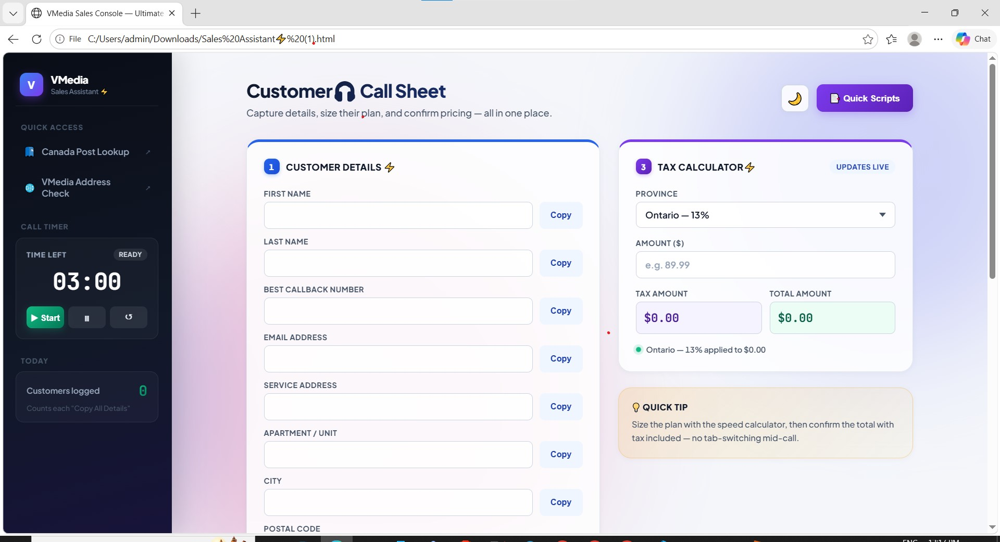

# ⚡ VMedia Sales Console — Ultimate Edition

> A production-grade, feature-rich web assistant engineered for high-efficiency sales operations. Built to eliminate mid-call tab-switching by unifying customer intake, dynamic speed sizing, provincial tax calculations, call pacing, and compliance scripting into a zero-latency single-page application.

---

## 📸 Application Visuals

| ☀️ Light Theme Dashboard | 🌙 Dark Theme Dashboard |
| :---: | :---: |
|  |  |

---

## 🌟 Overview & Business Impact

During high-volume outbound and inbound sales interactions, representative efficiency often suffers from application fragmentation—jumping across separate tabs for postal lookups, speed calculators, tax reference sheets, and CRM copy buffers.

The **VMedia Sales Console** addresses this operational friction directly by consolidating core workflow tools into a unified, high-density interface.

### Key Operational Outcomes:
* **Reduced Average Handle Time (AHT):** Streamlines data intake with one-tap field copying and unified formatting.
* **Zero Billing Errors:** Automated provincial tax engine prevents incorrect rate quotes prior to order submission.
* **Strict Quality & Compliance Adherence:** Real-time call timer and interactive checklists ensure mandatory disclosures are completed on every call.
* **Zero Infrastructure Overhead:** Client-side architecture runs locally in any browser with no server runtime or database dependency.

---

## 🚀 Key Features & System Capabilities

### 1. ⏱️ Precision Call Timer & Web Audio Alerts
* **Pacing Engine:** Integrated 3-minute interactive call timer designed to keep reps on schedule during discovery and pitch phases.
* **Audio Milestones:** Uses the native **Web Audio API** to generate pleasant frequency beeps at key time thresholds (e.g., 60-second warning, expiration) without requiring external MP3 assets.
* **Session Memory:** Uses `localStorage` to persist session count, elapsed time, and daily customer intake records across browser refreshes.

### 2. ⚡ Dynamic Bandwidth & Speed Sizing Calculator
* **Household Device Multiplier:** Calculates recommended internet download speeds based on active device counts and high-bandwidth usage profiles.
* **Scalable Sizing Logic:** Incorporates a baseline multiplier ($15 \text{ Mbps}$ per high-demand device) with intelligent rounding to standard telecom package tiers (e.g., $50 \text{ Mbps}$, $100 \text{ Mbps}$, $500 \text{ Mbps}$, $1 \text{ Gbps}$).

### 3. 🧮 Real-Time Canadian Provincial Tax Engine
* **Territorial Accuracy:** Pre-configured with complete federal and provincial tax tables for all Canadian provinces and territories (**GST, PST, HST, QST**).
* **Live Calculation:** Dynamically parses base service pricing and outputs exact tax breakdowns and total monthly costs as amounts are typed.

### 4. 📋 One-Tap Clipboard Automation & CRM Formatting
* **Field-Level Copying:** Dedicated copy triggers alongside each customer field (First Name, Last Name, Phone, Email, Address, Unit, City, Postal Code).
* **Composite Payload:** A single **"Copy All Details"** trigger formats the entire intake sheet into a clean, multi-line plain-text payload for instant paste actions into CRM systems or ticketing boards.

### 5. ✓ Compliance Tracker & Modal Script Repository
* **Interactive Checklist:** Tracks mandatory conversation checkpoints (Discovery, Terms & Conditions, 3-Email Overview, Order Closing).
* **Quick Scripts Modal:** Instant-access modal repository containing standardized compliance disclosures, objection handlers, and payment instructions with built-in clipboard triggers.

### 6. 🌓 Tokenized Design System & Theme Engine
* Dynamic theme toggle supporting custom **Light Mode** and **Dark Mode**.
* Preserves theme state across user sessions via `localStorage` and respects native operating system preferences (`prefers-color-scheme`).

---

## 🛠️ Technical Architecture & Stack

```text
┌────────────────────────────────────────────────────────────────────────┐
│                        VMedia Sales Console                            │
├──────────────────┬───────────────────┬─────────────────────────────────┤
│  HTML5           │  CSS3             │  Vanilla JavaScript (ES6+)      │
│  • Semantic DOM  │  • Custom Tokens  │  • Event Delegation             │
│  • Accessibility │  • Flexbox / Grid │  • Web Audio API                │
│  • Micro-UI      │  • Animations     │  • LocalStorage State           │
└──────────────────┴───────────────────┴─────────────────────────────────┘
